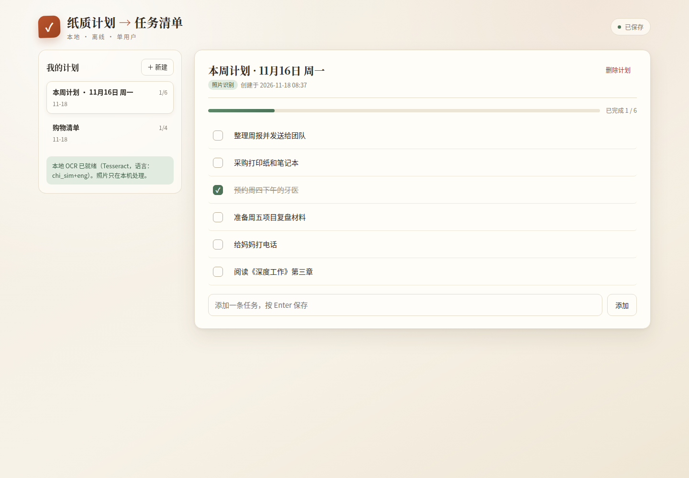
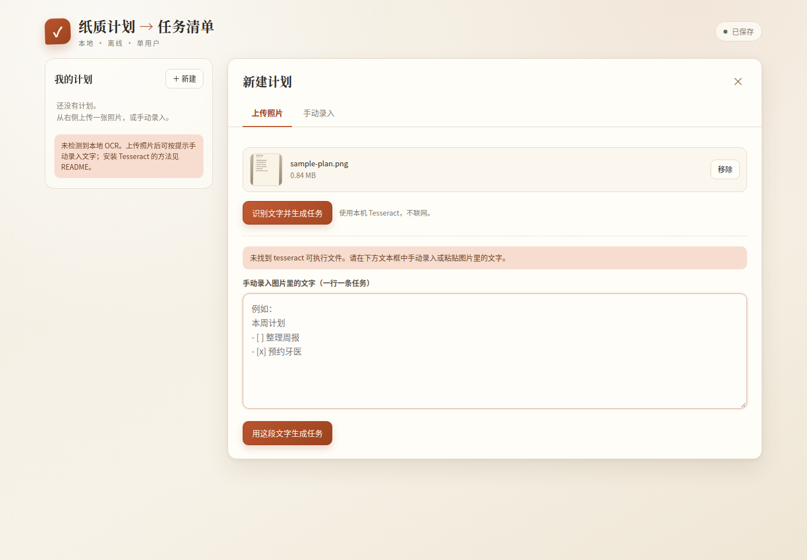
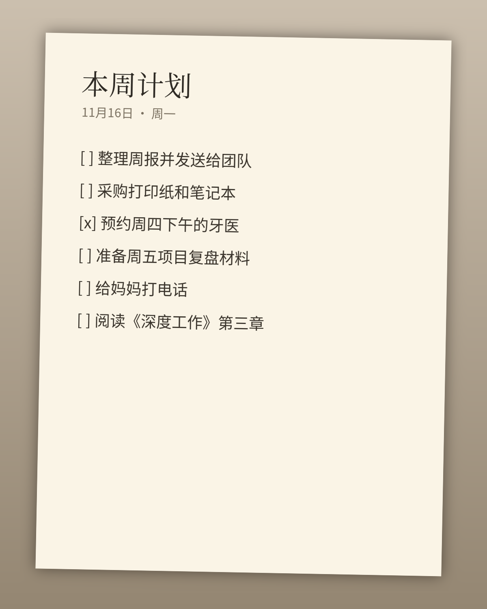

# 纸质计划 → 任务清单

把纸质日计划、周计划或待办清单的照片，变成一份可以编辑、勾选、保存在本机的任务清单。

v0 是单机、单用户、离线的桌面网页工具：Node.js 内置 HTTP 服务 + 原生 HTML/CSS/JS，没有 npm 运行时依赖；图片识别调用本机安装的 [Tesseract](https://github.com/tesseract-ocr/tesseract)，不调用任何云端或付费 OCR API。

## 功能

- **照片识别**：选择或拖入一张本地图片，用本机 Tesseract 识别文字。
- **保留原始顺序**：按行拆成任务，去掉 `-`、`1.`、`□`、`[ ]` 等标记。
- **可编辑**：点击任务文字即可修改，失焦自动保存。
- **可勾选**：复选框标记完成；照片里已经打了勾的任务会直接带入完成状态。
- **可持久化**：所有计划保存在本机 JSON 文件里，重启服务后仍在。
- **手动录入降级**：没有安装 OCR、或识别失败时，可以直接输入/粘贴图片里的文字，再生成任务。
- **多份计划**：左侧可切换、新建和删除计划。

## 界面



## 安装与运行

要求：**Node.js 20 或更高版本**。项目没有第三方 npm 依赖，不需要 `npm install`。

```bash
node --version    # 需要 >= 20
npm start
```

打开 <http://127.0.0.1:3000>。第一次保存计划时会自动创建 `data/plans.json`。

可选环境变量：

| 变量 | 默认值 | 说明 |
| --- | --- | --- |
| `PORT` | `3000` | 本地服务端口 |
| `HOST` | `127.0.0.1` | 监听地址；默认只允许本机访问 |
| `PLAN_DATA_FILE` | `data/plans.json` | 数据文件路径 |
| `PLAN_OCR_BIN` | `tesseract` | Tesseract 可执行文件路径 |
| `PLAN_OCR_LANG` | 自动选择 | OCR 语言，如 `chi_sim+eng` |

例如：

```bash
PORT=3210 PLAN_DATA_FILE=~/paper-plan/plans.json npm start
```

## 本地 OCR（可选但推荐）

程序启动时会检测本机有没有 `tesseract`。没有也能用，只是照片识别会引导你改用手动录入。

安装 Tesseract 和简体中文语言包：

**macOS（Homebrew）**

```bash
brew install tesseract tesseract-lang
```

**Ubuntu / Debian**

```bash
sudo apt update
sudo apt install tesseract-ocr tesseract-ocr-chi-sim
```

**Windows**

安装 [UB Mannheim 的 Tesseract 安装包](https://github.com/UB-Mannheim/tesseract/wiki)，安装时勾选 **Chinese (Simplified)** 语言数据；如果 `tesseract` 不在 `PATH` 里，用 `PLAN_OCR_BIN` 指向 `tesseract.exe`。

安装后确认语言包：

```bash
tesseract --version
tesseract --list-langs    # 应能看到 chi_sim 和 eng
```

程序会自动使用 `chi_sim+eng`；如果只安装了其中一个，会自动降级为可用的语言。OCR 只在本机运行，不联网、不需要 API key。

**没有 OCR 时**：上传照片后会看到提示，把图片里的文字输入或粘贴到下方文本框，再点“用这段文字生成任务”。这条路径不依赖 Tesseract。



## 使用

1. 点“新建”或“上传计划照片”，选择一张计划照片。
2. 点“识别文字并生成任务”。识别结果会按行拆成任务。
3. 在任务清单里：
   - 勾选/取消勾选复选框；
   - 点击任务文字直接编辑，按 Enter 或点别处保存；
   - 用行尾的 × 删除任务；
   - 在底部输入框添加任务。
4. 所有修改立即写入 `data/plans.json`。重启 `npm start` 后计划还在。

### 解析规则

- 一行一条任务，空行忽略；任务顺序与图片/文字中的顺序一致。
- 行首的 `-`、`*`、`•`、`1.`、`1)`、`(1)` 会被去掉。
- 复选框 `[ ]`、`[]`、`[x]`、`☐`、`☑` 会被去掉；带 `x`、`✓`、`☑` 的标记为已完成。
- 开头的日期行或“本周计划”“购物清单”“今日待办”这类短标题会作为计划标题，不当作任务。
- 也兼容 OCR 常见的残缺写法，如 `[]`、`x]`、行首单独的 `[`。
- 不做去重、不自动翻译、不合并多行；识别后可以手动编辑。

## 示例输入与输出

示例是合成的纸质计划图（不是真实照片，方便复现）：



用本地 Tesseract 识别：

```bash
tesseract examples/sample-plan.png stdout -l chi_sim+eng --psm 6
```

原始识别文字见 [`examples/sample-ocr.txt`](examples/sample-ocr.txt)，解析结果见 [`examples/sample-output.json`](examples/sample-output.json)：

```json
{
  "title": "本周计划 · 11月16日 周一",
  "tasks": [
    { "text": "整理周报并发送给团队", "done": false },
    { "text": "采购打印纸和笔记本", "done": false },
    { "text": "预约周四下午的牙医", "done": true },
    { "text": "准备周五项目复盘材料", "done": false },
    { "text": "给妈妈打电话", "done": false },
    { "text": "阅读《深度工作》第三章", "done": false }
  ]
}
```

注意第三行在图上已经勾选，所以 `done` 是 `true`。Tesseract 把这行的复选框识别成了 `x]`，解析器也能处理；其余几行识别成 `[]`，同样会被正确去掉。

## 测试

```bash
npm test
```

测试使用 Node.js 内置的 `node --test`，**完全离线**，不需要安装 Tesseract，也不会发网络请求：

- `test/parser.test.js`：解析规则、顺序、复选框、标题、OCR 残缺写法、空输入；
- `test/store.test.js`：创建/编辑/勾选/增删任务、重启加载、原子写入、损坏数据拒绝覆盖；
- `test/ocr.test.js`：缺少 Tesseract 时明确返回不可用；
- `test/server.test.js`：HTTP 接口、手动录入、照片上传（注入假 OCR）、无 OCR 降级、静态页面与路径穿越防护。

## 数据与安全

- 数据默认保存在 `data/plans.json`，已被 `.gitignore` 忽略。
- 每次修改先写临时文件再原子替换，避免写到一半损坏；数据文件损坏时程序会报错退出，不会静默覆盖。
- 服务默认只监听 `127.0.0.1`，没有账号体系——按“单机、单用户”设计，不要把端口暴露到公网。
- 照片会临时写入系统临时目录，识别完成立即删除；不会上传到任何服务器。

## 目录结构

```
server.js              HTTP 服务、API、静态文件
lib/parser.js          文本 → 任务解析
lib/store.js           JSON 持久化
lib/ocr.js             Tesseract 检测与调用
public/                原生网页界面
test/                  离线自动化测试
examples/              合成示例图、OCR 原文、解析结果
docs/                  界面截图与视觉证据
data/                  运行时生成的数据（不提交）
```

## 边界（v0 不做）

- 不做账号、登录、云同步、多设备协作。
- 不做移动端适配；界面按桌面浏览器设计。
- 不做多语言界面。
- 不接入需要联网的模型 API；OCR 只使用本机 Tesseract。
- 不做复杂版面分析（表格、多栏、手写连笔）；v0 以“一行一条任务”为主，识别不对时直接编辑。
